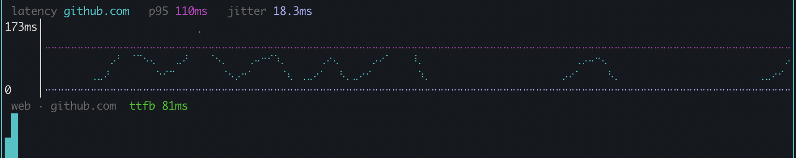
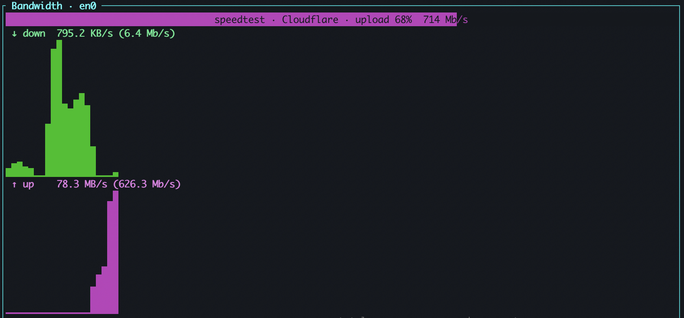
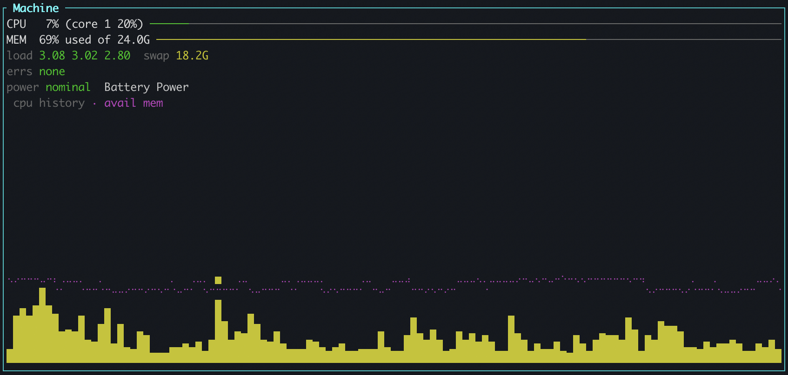
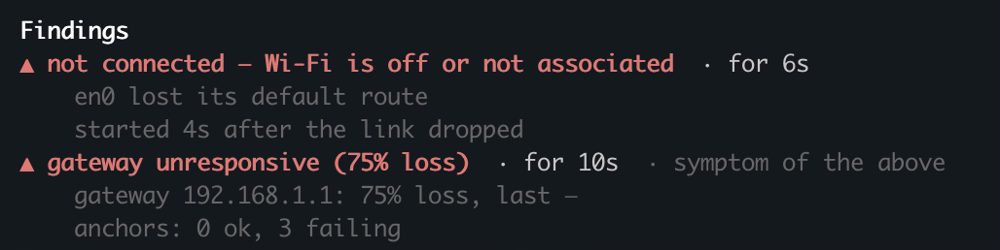

After I posted the [YouTube video](https://www.youtube.com/watch?v=bH9Jj0i5hDw) about octomon being useful for gamers, I got the following response from someone:

>Unless you are willing to put down some technical paper with the
>algorithms, metrics and evidence you designed, choose and collected,
>this is just an AI written slop with no scientific ground.
>
>Show that this tool closes a gap other tools (like CF's one) leave open
>and that the output it gives it's statistically correlated with a bad
>connection quality (not necessarily a connection with high latency,
>which is trivial to detect).

Challenge accepted... and I think this is a great idea. I work at Cloudflare and we often go to great lengths to document the technical details of how our services work.

I think what the commenter was getting at is that without a technical
explaination a tool like this is just words, and a high-latency detector is easy to build. So this document will be long, and to many people it will be boring. But I think it's important to have a technical paper that describes how octomon works, and why it works the way it does. I'll keep this a living document, so for each release I will review changes and ensure it is up to date.

## Scope

First, I don't want go into every detail of every function. This software is [open source](https://github.com/securitypedant/octomon) , if you **really** need to know the details piece by piece, just review the code (or point AI at it and ask). I want to focus this document on two areas I think most people are interested in when asking the question... "Why should I trust/use this?"

- Metrics collected in regards to the connectivity between the device and the Internet.
- The algorithms that lead to the analysis on the state and quality of that Internet connectivity.

Finally i'll describe what the tool [doesn't do](#6-what-this-establishes-and-what-it-does-not) and why.

Because octomon is open source, everything below can be checked against the code. 
All the methods of collecting data live in the [`collectors`](https://github.com/securitypedant/octomon/tree/main/src/collectors) folder.
The analysis rules we describe here live in [`src/verdict.rs`](https://github.com/securitypedant/octomon/blob/main/src/verdict.rs), The thresholds are constants in a module named `thresholds` at the top of that file. Every section below links to the files it describes.

So let's get into the details.

## 1. The question being answered

octomon has two primary goals. 

1. Provide an easy, visual way to review metrics and information that pertain to your current Internet connectivity.
2. Attempt to triage those metrics into some form of analysis and judgement so you can determine the quality of your connection and where connectivity might be failing.

For many years I would write scripts to ping hosts, analyse traceoutes and do DNS lookups. So when I started to write octomon, I wanted to embed the logic of those scripts into a single tool that could help me understand my connectivity better.

## 2. What is collected, panel by panel

All the monitoring data comes from the machine it runs on. Nothing is captured off the wire, and nothing is collected that the panels do not show or the analysis does not
use. This section reviews the four panels in the order they sit on screen and describes what is collected, how often, and how the colours which indicate connection quality are decided. The last section lists the few things collected only for the analysis.

### 2.1 Connection Quality

<figure>
  
  <figcaption>The Connection Quality panel.</figcaption>
</figure>

The panel is a table of **targets**, hostnames or IP addresses which we want to use
to measure the quality of the connection. One row each, with the latest round trip, the average, the 95th percentile, the maximum, the jitter and the packet loss. The rows are:

- **The built-in targets**, 1.1.1.1, 8.8.8.8 and 9.9.9.9. Three public
  DNS resolvers run by three different companies, chosen because they answer
  pings quickly from anywhere in the world because they use [anycast](/understand#anycast) addresses. They are the targets the analysis uses to
  decide whether the Internet is reachable at all, which is why there are
  three of them. If all three don't reply, either the Internet is offline or the path to it is. They are ordinary entries in the config's target list, so you can remove them. The analysis recognises them by address. If none of them are configured, your own targets become the jury instead.
- **octomon.dev**, a default target that serves a website (urr this one!), so the web probe always has one known destination.
- **The gateway** and **the first hops** of the path. At startup, and again
  whenever the network changes, octomon runs a traceroute towards 1.1.1.1.
  Hop 1 becomes the gateway row and hops 2 to 4 become hop rows. If the
  traceroute finds nothing, it is retried after 15, 30, 60, 120 and 240
  seconds, because a captive portal answers the first attempt with silence
  and signing in does not count as a network change. These rows are probed
  continuously from then on, not only when someone runs a traceroute, which
  is what lets the analysis say "ISP" rather than "somewhere out there".
- **IPv6 twins.** When the link has a global IPv6 address, each built-in target, the gateway and each hop gets a second row marked "v6", probed over IPv6. The two families are judged apart.
- **Your public IP**, discovered at startup, on a network change, and again whenever a monitored path changes.
- **Anything you add** by address or name: a game server, a company network device.
  These are judged one at a time and never vote on the Internet as a whole.

Code: [`discovery.rs`](https://github.com/securitypedant/octomon/blob/main/src/collectors/discovery.rs), [`config.rs`](https://github.com/securitypedant/octomon/blob/main/src/config.rs), [`app.rs`](https://github.com/securitypedant/octomon/blob/main/src/app.rs).

Three different methods of monitoring feed those rows:

| Probe | Which rows | Cadence | What it yields |
|---|---|---|---|
| ICMP echo | every row | every 1 s, 1 s timeout | a round trip time, or a miss |
| TCP connect to port 443 | every row except the gateway, the hops and the public IP: the built-in targets and their IPv6 twins, octomon.dev, and anything you added | every 1 s | a handshake time, or a miss: the same measurement where ICMP is blocked |
| HTTPS `HEAD /` | rows that serve a website | every 15 s once a server has answered; a new row is classified with retries every 10 s; one that refused or filtered port 443 is retried every 10 min; 4 s timeout | time to first byte, and whether the service answers |

Code: [`ping.rs`](https://github.com/securitypedant/octomon/blob/main/src/collectors/ping.rs), [`tcp.rs`](https://github.com/securitypedant/octomon/blob/main/src/collectors/tcp.rs), [`web.rs`](https://github.com/securitypedant/octomon/blob/main/src/collectors/web.rs).

The TCP probes run beside ICMP to the same
targets at the same cadence, so every ICMP-only judgement can be
cross-checked against a protocol that firewalls don't usually drop. When every ping
is lost by policy, the table switches to showing the TCP columns (`i` cycles
them by hand), and the analysis judges on them.

**What is kept per row.** Each row keeps a sliding window of outcomes, and
the statistics are computed over it. The columns use whatever window you
have chosen with `w`, from 30 seconds to 15 minutes. The analysis uses a
fixed window of the last 20 outcomes, so a rule means the same thing on
every screen.

| Statistic | Definition |
|---|---|
| loss | the share of misses among the window's outcomes |
| avg, p95, max | over the round trips in the window, windowed by probes sent rather than replies received, so under heavy loss they describe the present instead of freezing on old replies. No reply at all in the window shows dashes |
| jitter | [RFC 3550](https://www.rfc-editor.org/info/rfc3550/#page-94) interarrival jitter, `J += (abs(D) - J) / 16`, where D is the change in round trip between consecutive replies |
| floor | the 10th percentile of retained round trips, falling back to the minimum until 30 replies have been kept: the path's usual best, which one lucky reply must not set |
| minimum ever | kept separately for bufferbloat, whose question really is "how far above true idle" |

**How a row is coloured.** Every cell grades itself. The avg, p95 and max cells use the latency rule below. The loss cell uses the loss rule over the window you are viewing. The jitter cell is green below 30 ms, amber below 80 ms, red above 80 ms. The name and address cells take the row's overall colour, which comes from the latest round trip and the loss over the last 20 probes, loss first, then latency:

1. Loss is graded against the learned normal loss N for that kind of path
   (zero when none is known, see Section 3): **amber** at or above
   `max(1.5 × N, 1%)`, **red** at or above `max(2 × N, 5%)`. Loss
   is judged before latency because packets have no "normal" to hide behind.
2. If loss is fine, the latest round trip is graded against a reference R,
   the row's floor, lowered to the learned normal for that kind of path when
   one exists: **green** at or below `max(1.5 × R, 50 ms)`, **amber** up
   to `max(3 × R, 150 ms)`, **red** beyond.

The relative part is what makes a plane's 650 ms read as normal and a LAN
gateway's 40 ms read as a fault. The absolute floors are what keep a 2 ms
gateway from reading red at 6 ms. The same two functions grade the cells,
the rungs in the analysis and the findings, so the surfaces never
disagree about the same number.

Code: [`app.rs`](https://github.com/securitypedant/octomon/blob/main/src/app.rs) (`TargetStat`), [`verdict.rs`](https://github.com/securitypedant/octomon/blob/main/src/verdict.rs) (`loss_grade`, `rtt_grade`), [`ui.rs`](https://github.com/securitypedant/octomon/blob/main/src/ui.rs).

A row needs 5 outcomes before it has any opinion, I learned this the hard way,
because a single bad ping can throw off the statistics. A "bad" loss reading
needs at least 2 lost packets in the last 20: one dropped ping is 5%,
which is exactly the red threshold, and one dropped ping is not an outage.
A row with no reply in its window shows dashes rather than stale figures,
and a hop row, however red, never raises a finding by itself: routers
answer ICMP as a low priority, and a lossy hop that forwards perfectly is
the oldest false positive in path analysis. Section 4 says what a lossy hop
does count for.

<figure>
  
  <figcaption>The latency chart and web strip for github.com.</figcaption>
</figure>

**The latency graph.** Under the table sits a chart for one target, press `g` on a row display. Adding a target or starting a path monitor also switches the chart to that target.

The x axis is probes, not time. Each slot is one probe sent, two slots per character cell, so the chart always shows the most recent few hundred probes whatever the panel width, up to the 1000 the row keeps. Replies draw as a line in the accent colour. A probe that never came back keeps its slot and draws as a red band along the floor. That gives an outage width on the chart, and it cannot be spliced away when replies return. Two flat lines cross the chart: the p95 and the jitter over the current window. The title shows the same two figures.

On a network that drops ICMP as policy the chart says so in words instead of drawing a red band that would read as an outage.

Under the chart, a one-line web strip reports the same target's HTTPS probe. It reads "ttfb 81ms" when the server answers. It reads "not answering (N probes)" when a server that used to answer has stopped, and adds what ping was doing at the time. The other two states tell apart two kinds of silence on port 443. "port 443 refused" means the host answered the connection attempt with a refusal: it is up, and nothing is listening on 443, so it has no web service. "TCP filtered" means the connection attempt got no answer at all while ping to the same host works: the host is up, but something between here and there is dropping port 443. The first is a fact about the host. The second is a fact about the path. Mid-path hops are never web probed. Routers are not web destinations.

Code: [`ui.rs`](https://github.com/securitypedant/octomon/blob/main/src/ui.rs) (`latency_graph`, `web_graph`).

**Monitoring one target's path.** The table tells you a target is bad. It
does not tell you where. Pressing `m` on any row starts a continuous path
monitor for it, the view that `mtr` users will recognise:

<figure>
  
  <figcaption>The path to github.com, one row per hop, every hop probed every second.</figcaption>
</figure>

It walks the path once with a traceroute, up to 20 hops, then keeps an
ICMP probe running against every hop that answered the walk, on the same
one-second cadence as the table, staggered so a long path does not fire
twenty probes in the same instant. Each hop keeps the same statistics as a
target row, computed by the same code, so the columns mean the same thing
in both tables. The path is walked again every 60 seconds to pick up route
changes, and a hop whose address has not changed keeps its history across
the re-walk. When the re-walk finds the route changed, the events timeline
says what moved: which hop now answers from a different router, which hop
joined, and where the destination sits. A hop that merely stops answering
traceroute for one walk is not counted as a change, because routers
rate-limit their replies. The public IP is fetched again at that moment,
since a new path often means a new egress.

<figure>
  
</figure>

The sparkline beside each hop is its recent history, one bar per probe.
Bars are coloured by how that individual sample graded against the hop's
floor, not by the hop's current state, so a row that is green throughout
except for a red patch says the trouble was transient. A probe that never
came back draws as a full-height red bar. All hops
share the time axis, so one column is the same moment on every row. A hop
discovered late has a shorter history and is drawn narrower, pinned to the
right edge, so "now" still lines up down the column.

Three kinds of hop are deliberately drawn without alarm:

- A hop that never answered the walk shows `*` and dashes. A run of them
  collapses to one line, "5 hops not responsive", because one silent hop
  between two responders is informative and six in a row is noise pushing
  the useful rows off the screen.
- A hop that answered the walk but never answers a probe, while a later hop
  or the destination does, reads **silent** with no bars. Packets
  demonstrably pass through it; it just declines ICMP as policy. "100% loss"
  and a red bar would overstate it.
- A middle hop at 50% loss or more while later hops are clean is dimmed
  rather than coloured. Below 50% it keeps its normal colour. Routers answer ICMP as a low priority and forward
  everything else. Only the destination's loss is real and always keeps its colour.

The monitor is also an input to the analysis. Without one, the ISP path rung in the ladder reads the hop rows that discovery put in the table (Section 4.5). With one, it reads the whole path to the monitored target instead. Either way it grades hops 2 to 4, counts silent hops as policy, and marks the path as forwarding if anything beyond the gateway answers. When the built-in targets start losing packets, the analysis looks for the first hop in 2 to 4 with at least 5% loss over at least 10 samples whose loss persists to every later hop that answers. If it finds one, the finding's evidence says "loss begins at hop 3" and "loss persists on every later hop, not ICMP rate-limiting". That is the difference between "the Internet is bad" and "the second router past the gateway is bad".

Code: [`hopmon.rs`](https://github.com/securitypedant/octomon/blob/main/src/collectors/hopmon.rs), [`ui.rs`](https://github.com/securitypedant/octomon/blob/main/src/ui.rs) (`hop_monitor_view`), [`verdict.rs`](https://github.com/securitypedant/octomon/blob/main/src/verdict.rs) (`path_hops`).

### 2.2 Bandwidth

<figure>
  
  <figcaption>The Bandwidth panel: interface counters above, per-process talkers below.</figcaption>
</figure>

Two different sources feed this panel.

**The interface counters** of the default-route interface, read every
second: bytes, packets and errors in each direction. The bytes are the two
graphs, download above and upload below. The same read feeds two things elsewhere. The errs row
in the Machine panel shows errors as a share of frames. On a
wired link, the Network panel's utilisation graph plots the same bytes against the negotiated
link speed. Some VPN tunnel adapters have no counters (another learning I had, from NordVPN's NordLynx on Windows). Then octomon reads the physical
adapter underneath, which carries the same bytes encrypted. The panel title
names that adapter, and the fallback is logged to errors.log once per interface name. If neither can be found it sums every adapter except loopback.
That is honest, but it counts a tunnel's traffic twice, and I would like to [improve it](https://github.com/securitypedant/octomon/issues/19).

Code: [`throughput.rs`](https://github.com/securitypedant/octomon/blob/main/src/collectors/throughput.rs), [`app.rs`](https://github.com/securitypedant/octomon/blob/main/src/app.rs) (`LinkErrors`).

**Per-process and per-remote traffic**, every 2 seconds, from whatever the
platform offers without privileges:

 - `nettop` on macOS
  - kernel per-socket counters on Linux via `ss` (TCP sockets only, so UDP and QUIC traffic is not attributed; your own processes only, unless run as root)
 - kernel network ETW provider on Windows, the one Task Manager uses
(requires membership of the Performance Log Users group or run as Administrator). 

Those sources give
cumulative bytes per socket; octomon diffs successive samples into
per-interval rates and accumulates them two ways: onto the owning process,
and onto the remote address. The tables show session totals with the
current rate beside them, so a process that moved a gigabyte ten minutes
ago still ranks above one trickling now.

Each published row also keeps five minutes of its own rate, one sample per
two-second tick. Under the `/` filter the two graphs become stacked: the
filtered rows' summed rate drawn bright from the baseline, the rest of the
interface total dim above it. The two series come from different clocks and
different counters, so each talkers sample is placed on the graph by the
time it covered rather than by position, and a filtered sum can exceed the
interface total in a column, because loopback bytes count against a process
but never cross the wire.

Code: [`procbw.rs`](https://github.com/securitypedant/octomon/blob/main/src/collectors/procbw.rs), [`mod.rs`](https://github.com/securitypedant/octomon/blob/main/src/platform/mod.rs), [`etw.rs`](https://github.com/securitypedant/octomon/blob/main/src/platform/etw.rs).

<figure>
  
  <figcaption>A Cloudflare speed test under way: the download phase done, the upload phase at 68%.</figcaption>
</figure>

**The speed test**, when you press `s` it starts a local speed test with Cloudflare, M-Lab's NDT7,
LibreSpeed, or an iPerf3 server of your own (press `v` to cycle through). The HTTP based speed tests run several
parallel streams for a fixed duration, discard a warm-up period so TCP
slow-start does not bias the figure, and report steady-state throughput.
Latency to the test endpoint is sampled before the transfer (idle) and
during it (loaded). 

**Bufferbloat** is loaded minus idle, graded on the
Waveform and Cloudflare scale: excellent below 5 ms, good below 30,
moderate below 60, poor below 200, bad beyond. Each result is kept with
the provider and the far-end server that produced it, so later comparisons can be made.

Code: [`speedtest.rs`](https://github.com/securitypedant/octomon/blob/main/src/collectors/speedtest.rs), [`ndt7.rs`](https://github.com/securitypedant/octomon/blob/main/src/collectors/ndt7.rs), [`iperf3.rs`](https://github.com/securitypedant/octomon/blob/main/src/collectors/iperf3.rs).

### 2.3 Network

<figure>
  
  <figcaption>The Network panel on my home Wi-Fi.</figcaption>
</figure>

The Network panel is everything that describes the connection, with a few measurements.

- **Identity**, from the OS's interface tables, re-read every 5 seconds and on `r`. That poll is also how network changes are detected. It collects: interface, medium (Ethernet, Wi-Fi, cellular, tunnel),
  negotiated link speed, IPv4 and IPv6 addresses, the machine's MAC, the
  gateway's address and MAC, the DHCP server, the configured resolvers.
- **Public addresses**, IPv4 and IPv6, fetched at startup and on
  network change. (The rest of this document says v4 and v6, and "address
  family" or "family" always means IPv4 versus IPv6.) The v6 lookup runs
  only when the link has a global v6 address, and only after the v4 lookup
  succeeded, over a client bound to IPv6 so it cannot quietly answer over
  v4.
- **The edge's view**, from [`octomon.dev/edge`](https://octomon.dev/edge), at startup, on network
  change and every 15 minutes, over v4 and over v6. Because the website is hosted on Cloudflare, we can examine (using a Cloudflare [Worker](https://github.com/securitypedant/octomon/blob/main/worker/index.js)) which Cloudflare point of
  presence serves you, which ISP's network your traffic arrives from, and
  the TCP round trip from Cloudflare to you. It is the one measurement taken
  from the far end looking back, and it works on networks that block every
  ping. It is also the only endpoint I run.
- **DNS**, every 5 seconds: an `A` query for `example.com` to each
  configured resolver and to two reference resolvers, 1.1.1.1 and 8.8.8.8,
  giving latency and failure per resolver. Once a minute each resolver is
  also asked for a name that cannot exist; the honest answer is "no such
  name", and an address back means the resolver redirects misses to a
  search or ad page.
- **The web check**, every 12 seconds: a plain-HTTP fetch of your operating
  system's own connectivity-check URL, which is what detects a captive
  portal, and the same fetch again through the system proxy when one is
  configured.

Code: [`netinfo.rs`](https://github.com/securitypedant/octomon/blob/main/src/collectors/netinfo.rs), [`discovery.rs`](https://github.com/securitypedant/octomon/blob/main/src/collectors/discovery.rs), [`edge.rs`](https://github.com/securitypedant/octomon/blob/main/src/collectors/edge.rs), [`index.js`](https://github.com/securitypedant/octomon/blob/main/worker/index.js), [`dns.rs`](https://github.com/securitypedant/octomon/blob/main/src/collectors/dns.rs), [`http.rs`](https://github.com/securitypedant/octomon/blob/main/src/collectors/http.rs).

**The graph at the bottom** depends on what carries the traffic.

- On **Wi-Fi**, and on a tunnel running over an associated Wi-Fi radio
  (the radio is still the real bottleneck), it is the signal graph in the
  figure above: [RSSI](/understand#rssi) over time, normalised so that −100 dBm sits on the
  floor and −30 dBm at the top, with the transmit rate overlaid against its
  own peak so the two trends can be read together. The title carries the
  current dBm, coloured green at −60 or better, amber down to −72, red
  below, and the current tx rate.
- On a **wired** link (Ethernet, or a bridge) there is no RSSI, so headroom
  against line rate stands in for it: the same interface counters that draw
  the Bandwidth panel, replotted as download and upload percentages of the
  negotiated link speed on a 0 to 100% axis. The title reads "link 1000 Mb
  · ↓ 3.0% ↑ 1.0% of capacity". That is what tells you whether the cable or
  something upstream is the limit. When the OS does not report a line rate
  the graph scales against the highest rate among the samples on screen and
  the title says "link load (line rate unknown) · ↓ 3% ↑ 1% of peak", rather
  than inventing a capacity.
- On anything else, a cellular link or a tunnel with no radio under it,
  there is no graph.

Code: [`ui.rs`](https://github.com/securitypedant/octomon/blob/main/src/ui.rs) (`signal_graph`, `link_util_graph`), [`signal.rs`](https://github.com/securitypedant/octomon/blob/main/src/collectors/signal.rs).

### 2.4 Machine

<figure>
  
  <figcaption>The Machine panel on a laptop on battery: the vitals above, CPU and available-memory history below.</figcaption>
</figure>

Read every second from the OS: CPU as a whole and per core, memory
pressure (the share that is unavailable, because "used" sits near 100% on
any healthy machine thanks to caches), load average, swap, and the
interface's error counters. Thermal and power state are read every 30
seconds, because that probe runs a subprocess. Every other second the
process table is walked for the ten busiest by CPU and by memory, with CPU
per core as Activity Monitor and `top` report it. In full screen the panel
shows that process table, octomon's own footprint (so a monitor on a
struggling machine can show it is not the problem), the count of
connections and processes talking, and the uptime.

Code: [`vitals.rs`](https://github.com/securitypedant/octomon/blob/main/src/collectors/vitals.rs), [`ui.rs`](https://github.com/securitypedant/octomon/blob/main/src/ui.rs).

### 2.5 Collected for the analysis alone

A handful of probes have no column of their own and exist to aid in
analysis.

| Probe | When | What it settles |
|---|---|---|
| Path discovery, a traceroute toward 1.1.1.1 | at start and on network change, retried on a backoff from 15 s to 4 min while it fails | which addresses are hops 1 to 4 |
| NTP, three exchanges with `time.cloudflare.com` 300 ms apart, needing two replies that agree within 1 s | 4 s after start, 5 s after a network change, then every 15 min | whether the clock is wrong, which breaks HTTPS |
| Path MTU: UDP packets to 1.1.1.1 port 443 with Don't-Fragment set, shaped like a QUIC packet with an unsupported version so the far end answers without a session; a binary search over sizes in at most 12 steps | 8 s after start and after each network change, then every 30 min; put off for 2 min while the path is lossy | whether full-size packets vanish, the classic "ping works, downloads stall" |
| Proxy detection | at start, 3 s after a network change, then every 5 min | whether browsers go a different way than octomon's probes |
| Egress monitor: HTTP, QUIC, SSH, NTP and DNS to reference hosts | only while TCP 443 fails to every built-in target, every 5 s | whether a network is filtered or dead |

Code: [`discovery.rs`](https://github.com/securitypedant/octomon/blob/main/src/collectors/discovery.rs), [`clock.rs`](https://github.com/securitypedant/octomon/blob/main/src/collectors/clock.rs), [`pmtu.rs`](https://github.com/securitypedant/octomon/blob/main/src/collectors/pmtu.rs), [`proxy.rs`](https://github.com/securitypedant/octomon/blob/main/src/collectors/proxy.rs), [`egress.rs`](https://github.com/securitypedant/octomon/blob/main/src/collectors/egress.rs).

## 3. Learning a location

octomon learns what each network normally looks like and grades against that, which is what "~1ms normal here" in the analysis refers to.

A **location** is identified by a fingerprint. What goes into it depends
on the link:

- On Wi-Fi: the SSID and the gateway's MAC address.
- On a wire: the gateway's MAC address and the link medium. The gateway IP
  is used only when the MAC is unknown. The medium is part of the key, so
  the same router reached over cable and over Wi-Fi is two locations.
- With a full-tunnel VPN: the underlay gateway's MAC (or IP), the underlay
  medium, and the VPN vendor. When no underlay is visible, the vendor
  alone.
- With a split-tunnel VPN: the LAN's own fingerprint plus the vendor.
- With no gateway at all: the SSID alone.

The key is hashed before it is stored. DHCP renumbering does not change it.
A different router with the same generic SSID does. `N` names a location,
and `L` lists the ones octomon has seen, with what it learned about each.

<figure>
  
  <figcaption>Four learned locations, each with its own normal: home fibre, a phone hotspot with and without WARP, and a plane.</figcaption>
</figure>

Each location has a **baseline**, a set of exponentially weighted moving
averages:

- gateway round trip and p95, and gateway loss
- the lowest round trip among the targets, and the lowest loss among the
  targets. The two can come from different targets. Every target counts
  except the gateway and hop rows, so your own targets count too. The
  baseline takes the best because the question is "how far away is the
  Internet when the path is working".
- the best target's TCP connect time, the ICMP-free view
- the best target's web time to first byte
- DNS latency
- Wi-Fi signal
- speed-test download and upload throughput, when a test has run here

A baseline is fed by **folds**. One fold is one minute of 60 consecutive
seconds in which the connection looked normal, taken only after the first
two minutes of a session so startup transients do not teach the normal.
"Normal" here means: the analysis has a verdict (not still "measuring"),
no finding at down severity is standing, and no finding at degraded
severity is standing, with three exceptions:

- IPv6-broken and clock-skew findings never block a fold. They say nothing
  about the path.
- A latency-shaped finding (see below) lets the minute fold, but
  latency-blind.
- A degraded finding that has stood for 600 seconds is weather, not an
  episode, and the minute folds in full.

Notes never block a fold. A note can be a permanent trait of a location,
such as a gateway that drops ICMP as policy. Each fold contributes that
minute's windowed aggregates, folded in with
`new = old + 0.2 × (sample - old)`, which converges within an evening and
barely moves on one odd minute. A baseline is **established**, and the
relative grading in Section 2.1 switches on, after 5 folds. Until then the
title says "learning 2/5m" and the absolute floors do the judging.

**Latency-blind folds.** A minute folds latency-blind in two cases: a
bufferbloat finding or a "gateway latency inflated" finding is standing,
or this machine's own traffic is not quiet while the gateway or a target
reads inflated. In that minute the loss and signal figures still fold, and
so do the TCP connect and web figures. The gateway round trip and p95, the
target round trip and the DNS latency do not. So a download in progress
does not teach the location that 80 ms is normal.

**Weather.** A degraded finding that has stood for 600 seconds stops being
an episode and becomes the location's weather. A hotel network dropping
30% of ICMP all day is what normal looks like there. The folds resume, and
the learned loss normal is what the loss grading then uses. The
alternative, blocking the baseline forever, would mean a lossy location
could never establish, which is precisely the location that needs a
learned normal.

Speed tests do not fold. They are rare and deliberate, and a result
overwrites the expected throughput outright, unless a degraded finding was
standing at the time or the analysis was still measuring. An empty slot is
filled regardless, so the first test on a location always counts.

Code: [`baseline.rs`](https://github.com/securitypedant/octomon/blob/main/src/baseline.rs) (`fingerprint`, `Baseline`, `fold`), [`verdict.rs`](https://github.com/securitypedant/octomon/blob/main/src/verdict.rs) (`baseline_step`).

## 4. The analysis pane, top to bottom

Now we get to the real meat. This has been the hardest part of building octomon
and to be honest, this is still a work in progress. But it is a massive improvement
over the patchwork of scripts I have been writing for the past 20 years.

<figure>
  
  <figcaption>The analysis pane: the ladder, the checks, the performance grade, the history line and the findings.</figcaption>
</figure>

While octomon is running, press `y` and the pane shows a ladder of eight rungs, a list of checks, the
performance grade, a line of history, and the findings. The rules run in
roughly ladder order: link, gateway, the physical link, DNS, Internet and
ISP path, destinations, web, clock, and the machine last. Each rule
decides for itself whether its finding is a symptom of something lower
down. With no link, every network finding is a symptom. DNS is a symptom
when the gateway is bad or two built-in targets are. A LAN target that
fails is a symptom of the gateway. A dead link explains a dead gateway,
which explains failing DNS. The analysis runs once a second over the
current state, and Section 4.10 says how its output is steadied before it
reaches the screen.

Code: [`verdict.rs`](https://github.com/securitypedant/octomon/blob/main/src/verdict.rs) (`evaluate`, `build_rungs`, `checks`).

Let's examine how we calculate each rung.

### 4.1 machine

A pegged CPU or a machine that is swapping makes a perfectly good connection feel broken, and no network tool looks there, so this rung rules the machine in or out before anything upstream gets the blame.

**Rung.** Three conditions feed it: CPU at or above 90% of the whole
machine, memory pressure at or above 90%, and the OS reporting the CPU is
being held back (a thermal or power limit on macOS, battery saver on
Windows; Linux offers no unprivileged answer, so it is not guessed at).
Any one of them alone is **amber**. **Red** needs the CPU pegged *and* one
of the other two, because a pegged CPU is the only machine condition that
disturbs the network readings themselves: probe timing slips and replies
queue, so latency and jitter inflate for reasons the network knows nothing
about. With the machine also swapping, or the clock held back, what is
left of it is saturated and everything above this rung is suspect. A
machine that is merely busy, warm or full never impacts the footer. Grey
until the first sample. Green otherwise. The detail is CPU usage and
available memory, with "cpu held back" appended when the OS reports it.

Code: [`verdict.rs`](https://github.com/securitypedant/octomon/blob/main/src/verdict.rs), [`vitals.rs`](https://github.com/securitypedant/octomon/blob/main/src/collectors/vitals.rs), [`platform/mod.rs`](https://github.com/securitypedant/octomon/blob/main/src/platform/mod.rs) (thermal state).

<figure>
  
</figure>

**Findings.** Below the red line, each condition is a note on its own.
"machine under load" at 90% CPU, naming the three busiest processes,
because the process is the thing you want to close. One
saturated core does not count. "memory nearly full" at 90% pressure. "cpu held back by the OS"
whenever it says so, with the note that speed tests and encrypted tunnels
may run below line rate; ordinary traffic rarely notices a capped CPU, and
it does not lose or delay packets. Notes explain a slow machine, not a bad
connection. Above the red line the three collapse into one degraded
finding, "machine saturated", carrying all the facts as its evidence and
the warning that readings taken on a saturated machine are unreliable.
Either way the rung's colour matches the finding by construction, and
either way a machine finding ranks below any network cause: it colours the
reading of everything else, it never outranks it.

### 4.2 link

Everything else is measured through this link, so a weak radio or a bad cable has to be found first, or every finding above it is a symptom with false information.

**Rung.** First, is there a link at all: no default route, an address but
no gateway, or only a self-assigned 169.254 address with no global IPv6,
are each red, and each becomes the finding at the bottom of the ladder
with every other failure marked as its symptom. With a link, the rung
grades its quality from two things: the radio, on Wi-Fi, and the
interface's own error counters on either medium.

On Wi-Fi: radio signal strength at or below -82 dBm is red, amber at or below -75 dBm, green otherwise, with the rate in the detail; grey with no signal sample yet.

Interface errors are frames the hardware received or sent corrupted, as a
share of all frames. The share is judged over the last **20 seconds**, and
only once at least **100 frames** have crossed the link in that window: one
corrupted frame among fifty on an idle link is 2% for that second and
nothing at all, so a quiet link gets no opinion rather than a noisy one.
The lines differ by medium, because the counters mean different things:

| Medium | amber | red |
|---|---|---|
| Wired | 0.1% | 1% |
| Wi-Fi | 2.5% | 5% |

A wire should run at zero. Carrier Ethernet gear raises a "signal degrade"
alarm from a configurable rate that is conventionally one frame in a
thousand ([Nokia's port monitoring](https://documentation.nokia.com/sr/23-7-1/books/interface-configuration/ethernet-port-monitor.html)
judges it over a 10-second sliding window, much as octomon does), and at
one in a hundred the link is losing traffic before the IP stack ever sees it, which
is a bad lead, a bad port or a duplex mismatch. A radio is different: its
driver counts decryption failures, malformed frames and the frames it
drops at the edge of range as receive errors, so some error rate is the
normal state of a working Wi-Fi link. There is no standard for how much.
The nearest thing to field consensus is from people who monitor access
points for a living: a [Checkmk thread](https://forum.checkmk.com/t/what-are-recommended-error-rate-thresholds-for-wireless-access-point-interfaces-e-g-ath0-wifi0-etc/31094)
settles on 2.5% warning and 5% critical after finding the usual wired
lines "clearly too low for wireless", and an [Aerohive thread](https://community.extremenetworks.com/t5/aerohive-migrated-content/we-have-some-wifi-issues-in-the-performance-and-associating/td-p/64477)
calls 4% "not bad" in a dense, interference-heavy environment. octomon
uses those two numbers, and I'd treat them as provisional until there is
field data from this tool to refine them.

<figure>
  
</figure>

**Findings.** The link-state findings above. On Wi-Fi, a finding fires
when the signal is at or below -82 dBm, or the signal-to-noise ratio is
under 15 dB, or the radio's error share crosses its red line. It is
degraded, "Wi-Fi link is weak (rssi N dBm)", when the gateway is also bad,
because then the radio explains the loss at hop 1. Otherwise it is a note,
"Wi-Fi signal weak (rssi N dBm), not yet hurting". At or below -85 dBm the
radio is almost certainly the whole problem, and the finding's confidence
becomes strong. The SNR test is only in the finding; the rung ignores it,
so the rung can be green while the note is up. On a wire, "link errors
creeping in" as a note from the amber line and "link errors" as a degraded
finding from the red one, each carrying the totals since start and the
window the share was judged over.

Code: [`verdict.rs`](https://github.com/securitypedant/octomon/blob/main/src/verdict.rs), [`app.rs`](https://github.com/securitypedant/octomon/blob/main/src/app.rs) (`LinkErrors`), [`signal.rs`](https://github.com/securitypedant/octomon/blob/main/src/collectors/signal.rs).

### 4.3 gateway

The gateway is typically the last device before the Internet: if it answers cleanly the fault is beyond your local network, and if it does not, nothing past it can be judged at all.

**Rung.** The health of hop 1 over the last 20 pings. Loss is graded with
the loss rule from Section 2.1 against the gateway's learned normal.
Latency is "inflated" when the mean round trip is above three times the
session's floor, or above 60 ms, whichever is higher. The detail shows the
p95 and the loss, and "~30% loss normal here" when the learned normal is
itself 5% or more. Three overrides stop it lying:

- The gateway at 50% loss or more while at least 2 built-in targets are
  not bad and none is bad. Every one of those packets went through the
  gateway, so it forwards. It is dropping ICMP addressed to itself as
  policy, as airport and hotel routers routinely do. The rung is green and
  the finding is a note, "gateway drops ICMP (forwarding fine)".
- When the whole network blackholes ICMP or filters port 443, "100% loss"
  measures the policy, not the gateway: grey, not red.
- When the "degraded but usable" rule in Section 4.10 has fired, amber at
  worst, because red would say "outage" about a link you are browsing
  over. That rule needs more than a working web check: the location must
  not be one whose baseline says it is normally clean. This took a while
  to learn from testing.

<figure>
  
</figure>

**Findings.** A gateway finding when hop 1 is bad and none of the
overrides hold. "gateway unresponsive (N% loss)" is down at 50% loss or
more and degraded below that. "gateway latency inflated (41ms vs 14ms
floor)" is degraded, and when the location's baseline is established the
evidence adds "gateway 41ms vs ~2ms normal at Home (20×)". A dead gateway
takes the targets with it within seconds, and that state reads as down.
Latency inflated at the gateway together with at least half the targets is
attributed to the shared first hop, the access link, rather than to the
gateway device or the Internet.

Code: [`verdict.rs`](https://github.com/securitypedant/octomon/blob/main/src/verdict.rs) (`probe_health`, the gateway block of `evaluate`), [`baseline.rs`](https://github.com/securitypedant/octomon/blob/main/src/baseline.rs).

### 4.4 DNS

A connection that cannot resolve names cannot reach anything by name, so DNS gets a rung of its own instead of being folded into "the Internet is slow".

**Rung.** Using this network's own resolvers, each needing at least 3
probes. A resolver is "failing" when half or more of its recent probes
failed, with one shortcut: three failures in a row counts as failing and
three answers in a row counts as not failing, whatever the percentage. Red
when every resolver is failing. Amber when some are failing, or when the
slowest mean is above 120 ms. Green otherwise. The detail shows the worst
mean, and mentions the reference resolvers in a clause as the contrast,
not the rung.

<figure>
  
</figure>

**Findings.** A connection that cannot resolve names cannot reach anything
by name, however well it pings. So every configured resolver failing is
an **outage**, the same tier as a dead link or the Internet unreachable
past the gateway: it paints the footer red and counts as down time in the
history. The contrast with working pings is what makes it the cause
rather than a symptom; if the gateway or two of the built-in targets are
failing too, the DNS finding is marked a symptom and ranks below whatever
is actually broken. The full set, by tier:

| Finding | Tier | When |
|---|---|---|
| "DNS not answering (all N resolvers failing)" | down | every configured resolver failing, the reference resolvers too |
| "your DNS resolvers not answering, 1.1.1.1 works: switch DNS to it" | down | every configured resolver failing while a reference resolver answers, so the advice can be specific |
| "DNS slow on every resolver" | degraded | no resolver is clean, but at least one still answers: all slow, or some failing and the rest slow. |
| "local DNS X down, internet OK, local names won't resolve" | degraded | the LAN's own resolver down while public ones answer: Internet names resolve, local device hostnames do not |
| "resolver X redirects non-existent names to an address" | degraded | the once-a-minute probe for a name that cannot exist comes back with an address |
| "N of M DNS resolvers failing, others fine" | note | a public resolver down while the LAN's answers |
| "resolver probes blocked on this network, names still resolve" | note | every resolver probe failing while the OS web check fetched a hostname fine: a filter on port 53, not a DNS outage |
| "a local DNS proxy handles resolution, probes not answerable" | note | the same, when every configured resolver is a loopback address: an AdGuard-style filter answers the OS, not octomon |
| "outside resolvers blocked, 1.1.1.1 and 8.8.8.8 unreachable while this network's DNS works" | note | the reference resolvers filtered: apps with their own DNS settings will fail here |

The two outage rows are the only DNS findings that can headline the
footer in red. Everything in the degraded tier is amber, and the notes
keep "connection healthy" with the note appended.

Code: [`verdict.rs`](https://github.com/securitypedant/octomon/blob/main/src/verdict.rs), [`app.rs`](https://github.com/securitypedant/octomon/blob/main/src/app.rs) (`DnsProbe`), [`dns.rs`](https://github.com/securitypedant/octomon/blob/main/src/collectors/dns.rs), [`config.rs`](https://github.com/securitypedant/octomon/blob/main/src/config.rs) (reference resolvers).

### 4.5 ISP path

The first hops past the gateway belong to whoever carries the traffic out, an ISP at home, the campus core in an office, the provider's fabric in a cloud VM, and this rung is what lets the analysis name that segment rather than "somewhere out there". "ISP" is its short name, not an assumption about where octomon is running.

**Rung.** The worst loss among hops 2 to 4: red at or above 5%, amber at
or above 1%, green below. Two things can measure those hops. The path
monitor, when you have started one with `m`, sees the whole path to its
target. Without one, the rung reads the hop rows that discovery put in the
Connection Quality table at startup and has been probing every second,
with the built-in targets standing in as the far end of the path; the
detail then ends "[m] for every hop", because the monitor refines the
answer rather than being the only way to get one. A hop that answers
nothing while a later hop or the far end answers cleanly (under 5% loss)
is counted as silent, not lost: the packets demonstrably pass through it.
If every early hop is silent while the path forwards, the rung is green
and says so. It is grey in two cases: discovery found no answering hop
past the gateway and no monitor is running, or hops are known but none
has enough samples yet and nothing past the gateway answers ("watching
the path, no hops answering yet").

The IPv4 and IPv6 paths are graded apart. They share nothing past the
gateway, so a silent v6 hop says nothing about whether v4 forwards, and a
lossy one is a v6 fault. Under discovery the v6 twins of the hop rows form
their own path with the v6 twins of the built-in targets as its far end;
the rung takes the worse of the two address families, and the detail leads with
v4 and names v6 in a clause ("hops 2-4 · worst loss 0% · v6 worst loss 0%,
1 silent"), so a v6-only problem reads as one rather than painting the
whole rung with no hint of which family.

<figure>
  
</figure>

**Findings.** "ISP path degraded, loss begins at hop N" fires inside the
Internet rule below when a hop numbered 2 to 4 shows at least 5% loss over
at least 10 samples **and that loss persists on every later hop that
answers**. A lossy hop followed by clean ones is the rate-limiting case from
Section 2.1 and is ignored. The persistence requirement is the whole rule;
without it this would be exactly the false positive it is designed to avoid.

Code: [`verdict.rs`](https://github.com/securitypedant/octomon/blob/main/src/verdict.rs) (`path_hops`, `grade_path`), [`hopmon.rs`](https://github.com/securitypedant/octomon/blob/main/src/collectors/hopmon.rs).

### 4.6 internet

We base this judgement on three resolvers run by three different companies determining whether the Internet is reachable at all. The logic here is that if everything else to this point is good, then we should be able to reach these resolvers. Because they all use [anycast](/understand#anycast) networking, they are massively reliable points of reference.

**Rung.** The consensus of the built-in targets over the last 20 pings:
red when at least 2 are bad (amber instead when the web check shows the
link is usable), amber when one is bad, or the worst loss grades above
good, or at least half the targets are latency-inflated, green otherwise.
The detail is the count, the worst p95 and the worst loss. Latency counts
towards the colour because an earlier version graded only loss, and showed
a green tick beside "worst p95 504ms" while the table graded the same rows
red. When ICMP is blackholed the rung reads the TCP 443 series instead.
When 443 is dark everywhere it reads the egress monitor and is amber at
most, because something is getting out.

<figure>
  
</figure>

**Findings.** One finding, when the gateway is fine, at least 2 built-in
targets are bad, and the bad ones are at least half of those with data.
It reads "internet unreachable beyond the gateway" at down, when every bad
target is at 50% loss or more, and "internet degraded beyond the gateway
(N of M anchors failing)" at degraded otherwise. Only the built-in targets
vote. Targets you add, game servers and company devices that may never
have answered a ping in their lives, are judged one at a time in 4.8 and
are never more than a note, with two exceptions: if no built-in target is
configured at all, your own targets become the jury; and a target you
added on the local network that stops answering is degraded, because that
is your LAN, not the Internet. The corroboration comes from the web check
failing too, or from every target being out.

Code: [`verdict.rs`](https://github.com/securitypedant/octomon/blob/main/src/verdict.rs), [`config.rs`](https://github.com/securitypedant/octomon/blob/main/src/config.rs) (the built-in targets), [`egress.rs`](https://github.com/securitypedant/octomon/blob/main/src/collectors/egress.rs).

### 4.7 web (HTTP)

Ping can succeed while the web fails, and the reverse, so this rung checks the protocol you are most likely using the most. A real HTTP fetch through the system resolver, over each address family.

**Rung.** The web check runs once over IPv4 and, when the machine has a
global IPv6 address, once over IPv6. Red for a captive portal, when both
families fail, or when the check fails on the only family the machine has.
Amber when it fails over one family and works over the other, because
browsers fall back quickly but plenty of other software does not. Green
when it works. Grey until the v4 check has run.

There is one more amber case. The connectivity check is plain HTTP on
port 80, but the web as people use it is HTTPS on port 443. A network
that blocks 443 and leaves 80 open passes the check and breaks every
website, and before this rule it left every rung green. So the rung also
goes amber when the port-80 check passes while the TCP connects to port
443 are failing to every built-in target (50% loss or more on each), with
the link up and no captive portal.

<figure>
  
</figure>

**Findings.** "captive portal, open this network's sign-in page" comes
first. Nothing else matters until that is dealt with.

When 443 is dark to every built-in target while the link is up, the
[egress monitor](https://github.com/securitypedant/octomon/blob/main/src/collectors/egress.rs)
starts. It tries HTTP, QUIC, SSH, NTP and DNS to reference hosts every 5
seconds, and the finding names what got out. A 443-only rule reads "HTTPS
blocked on this network, port 80 still answers, port 443 does not". A
wider filter reads "web blocked on this network, SSH, NTP and DNS get out;
HTTP and QUIC blocked". Either way it is a filter named port by port, not
an outage, and a reference resolver answering over UDP 53 is further proof
the path is up.

"web traffic blocked while ping works, proxy or firewall" fires when the
plain check fails and the path is demonstrably up. With a proxy configured
it becomes "direct web blocked, this network requires the configured
proxy, which works" or "the configured web proxy is not answering",
because browsers and direct traffic then fail separately. "web check to X
unanswered, ping still fine" fires for a target whose site answered and
has since stopped.

Code: [`verdict.rs`](https://github.com/securitypedant/octomon/blob/main/src/verdict.rs) (`https_dark`, the web block of `evaluate`), [`http.rs`](https://github.com/securitypedant/octomon/blob/main/src/collectors/http.rs), [`proxy.rs`](https://github.com/securitypedant/octomon/blob/main/src/collectors/proxy.rs), [`web.rs`](https://github.com/securitypedant/octomon/blob/main/src/collectors/web.rs).

### 4.8 destinations

The targets you added are the services you actually want to monitor so this rung reports on them one at a time without letting one non responsive target vote the whole Internet down.

**Rung.** This rung looks at individual targets, the built-in ones and
any you added, and asks which of them are struggling while the connection
as a whole is fine. The seven rungs above it judge the connection from the
consensus of the built-in targets. This one is the only rung that reports
on targets one by one. Green when they all answer. Amber naming the ones
that are slow or lossy, and naming any that have never answered a ping on
this network under "never answered pings", because a host that ignores
ICMP is not a destination that went away. Red when a built-in target that
used to answer is at 50% loss or more, and red with "none reachable, cause
judged upstream" when every built-in target is bad and the "degraded but
usable" rule has not fired. During a speed test the detail says so, since
every row reads lossy at once. When ICMP is blackholed the odd ones out
are read off the TCP series.

<figure>
  
</figure>

**Findings.** "X unreachable, your connection is fine" or "X degraded,
your connection is fine" for one target that is bad while the gateway and
at least 2 targets are fine. For a target you added it is always a note,
so the footer and the session bar are not affected and keep describing the
connection. For a built-in target that used to answer and is now at 50%
loss or more it is degraded. A target that has never answered a ping here
is a note, whoever it belongs to. A quiet host whose web service answers
is reported as up, just quiet.

Code: [`verdict.rs`](https://github.com/securitypedant/octomon/blob/main/src/verdict.rs), [`web.rs`](https://github.com/securitypedant/octomon/blob/main/src/collectors/web.rs), [`tcp.rs`](https://github.com/securitypedant/octomon/blob/main/src/collectors/tcp.rs).

### 4.9 the checks

Below the ladder is a list of overall checks and general status indicators that provide an indication on connection quality and report true or false rather than good or bad.

- **ICMP** and **egress**: two rows you will not see on a healthy network,
  because they exist only while the condition they describe exists. "ICMP"
  appears at the top of the list while every ping is being dropped due to 
  policy, so the judgement is running on web and DNS
  evidence alone. "egress" appears once the egress monitor has started.
  While it runs, the row says which ports got out and which were blocked.
  After the web comes back it stays for the rest of the session, saying
  when it stopped and what the last round found.
  On a plane, a hotel or a corporate network you may often see both; at
  home you should see neither.
- **discovery**: what the startup traceroute found and when it found only
  the gateway we are likely on a wireless hotspot. Basically reporting on how much of the immediate network path the tool can see.
- **edge**: Which Cloudflare point of presence serves this machine, which
  network the traffic arrives from, and the edge's round trip back to us.
  Then the same over v6. The network is named by its AS number and, when
  Cloudflare knows it for that prefix, the operator's name. Some prefixes
  carry the number only; if the v6 answer names the same AS, that name is
  used. If the address the edge saw is
  not the public IP octomon fetched, the row says so and goes amber which indicates 
  the two requests left by different paths. The same answer carries the
  latest released version. At startup a newer one is shown in a notice that
  any key dismisses; found later, it only goes on the timeline. octomon never
  updates itself.
- **public IP**: The public v4 and v6 addresses octomon fetched.
- **nat**: How many layers of NAT sit between this machine and the
  Internet. If the gateway has a private address and hop 2 is also
  private, the row says carrier-grade or double NAT and shows the hop-2
  address. Otherwise it says "ordinary NAT at the gateway". This decides
  whether port forwarding and peer-to-peer can work.
- **clock**: How far the system clock is from the time based on an NTP server 
  octomon polls an NTP server once at startup and every 15 minutes. If the
  two differ by 30 seconds or more, the row shows the offset and the
  analysis adds a note, because time-based logins (TOTP codes) can start
  failing. If they differ by 5 minutes or more, it becomes a degraded
  finding, because HTTPS certificate checks will fail leading to 
  every website breaking while nothing on the network is wrong. Without an
  NTP answer, the clock is compared against the Date header of the HTTP
  check instead. That reading is coarse, so it can only ever raise the
  note, never the finding.
- **proxy**: Whether a system proxy is configured. If one is, the row
  names it and the HTTP check is repeated through it.
- **path MTU**: The largest packet size that got through, for v4 and for
  v6. "not measured" means the probe could not run, with the reason: the OS
  fragments packets itself, the platform is not supported, or a socket
  error. "not judged" means one of two things. Either the path was
  dropping 20% or more of packets of every size at the time, so a timeout
  says nothing about size, or nothing answered at any size, which usually
  means UDP 443 is filtered.
- **DNS honesty**: How many resolvers answered "no such name" honestly
  when asked for a name that cannot exist.
- **reference DNS**: Whether each reference resolver answers, and how
  fast. If any of them answer, the Internet path is up no matter what
  pings and the web check say.
- **IPv6**: Whether IPv6 works end to end. The row says "works end to end"
  when every judged v6 twin of the built-in targets is under 50% loss, and
  appends the v6 web check's result and whether the v6 router answers. If
  not, it says what it sees: "address but no route", "ICMPv6 filtered", or
  "N of M v6 anchors answer". The finding that goes with a broken v6 path
  names the router when the router itself is the one not answering.

Code: [`verdict.rs`](https://github.com/securitypedant/octomon/blob/main/src/verdict.rs) (`checks`), [`edge.rs`](https://github.com/securitypedant/octomon/blob/main/src/collectors/edge.rs), [`clock.rs`](https://github.com/securitypedant/octomon/blob/main/src/collectors/clock.rs), [`pmtu.rs`](https://github.com/securitypedant/octomon/blob/main/src/collectors/pmtu.rs), [`proxy.rs`](https://github.com/securitypedant/octomon/blob/main/src/collectors/proxy.rs), [`dns.rs`](https://github.com/securitypedant/octomon/blob/main/src/collectors/dns.rs), [`app.rs`](https://github.com/securitypedant/octomon/blob/main/src/app.rs) (`nat_kind`).

### 4.10 from readings to findings

Three mechanisms sit between the rules above and what you read at the bottom of the analysis panel.

**Corroboration.** Every finding gets one of three confidence levels, and one function decides it for every rule, so "strong" means the same thing everywhere. The function asks three yes-or-no questions.

1. Does the contrast hold? Each rule has a comparison that separates its cause from everything else. For DNS it is "pings work but names don't resolve". For the gateway it is "the gateway is fine but the targets beyond it fail". If that comparison holds, the finding is pointing at the right layer.
2. Is there a second, independent piece of evidence? Something that would not be fooled by the same fault. Three things count: the learned baseline says this is far from normal here; a different kind of probe agrees (the TCP probes agree with the pings, or the web check agrees with DNS); or the problem persists down the path to later hops.
3. Is there evidence against it? Either something contradicts it, or the finding is explained by a failure lower on the ladder. DNS timing out when the gateway is dead is not a DNS problem. It is a symptom.

The level falls out of those answers. Evidence against always wins: a
finding with something against it, is never promoted, however good the
rest of its evidence.

| Evidence against | Contrast | Second source | Level |
|---|---|---|---|
| yes | any | any | weak |
| no | yes | yes | strong |
| no | otherwise | | likely |

When several findings are active, the headline in the footer is the top of a ranked list. The sort order is:

1. Caveat-class findings last, whatever their severity. "You are on a VPN" and "the machine is busy" change how you should read the other findings, but they never become the headline while a network cause exists.
2. Causes before symptoms. A symptom is any finding its rule marked as explained by something lower on the ladder, and symptoms sort below causes.
3. Higher severity first: down, then degraded, then notes.
4. Higher confidence first: strong, then likely, then weak.
5. Then the cause order, as a tiebreak: no link, captive portal, degraded-but-usable, gateway, Wi-Fi or wired link, DNS, local DNS, DNS hijack, ISP hop, Internet, IPv6, path MTU, web filtered, web blocked, web target, single destination, bufferbloat, clock.

So a weak finding can lead, if it is the most severe thing standing. Confidence only separates findings of equal severity.

Code: [`verdict.rs`](https://github.com/securitypedant/octomon/blob/main/src/verdict.rs) (`judge`, `rank`, the `Cause` enum).

<figure>
  
  <figcaption>Ranking in practice: the dead link leads, and the gateway failure behind it is marked as its symptom.</figcaption>
</figure>

**Two demotions.** Pings are octomon's main measurement, but pings can
lie in one direction: a network can drop them while everything else
works. Two rules catch that and demote the ping-driven findings before
they reach you.

*Degraded but usable.* This fires when all of the following hold:

1. The gateway rule (on loss), the ISP path rule or the Internet rule has
   fired at degraded or worse on the ICMP evidence, so the ping view says
   the connection is down.
2. There is a link. With no link there is nothing to demote.
3. The plain-HTTP check succeeded. A real page loaded over this link, so
   names resolved and traffic got through.
4. This location's learned baseline does not say the connection is
   normally clean. On a plane or a hotel, loss is the known state of the
   link. On a connection that is normally clean, that same loss is an
   incident, and this rule stays off so it is reported loudly.

When it fires, working web traffic is taken as stronger evidence than
lost pings. The ping-driven findings are removed and replaced by one note,
"degraded but usable", which lists what the ICMP view had claimed and
says what to expect: slow pages and stalling calls, not an outage.

*ICMP blackholed.* This is the state where every built-in target with
enough samples is at 99.5% loss or more while the HTTP check succeeds.
That is not an outage. It is a network dropping ICMP as policy, which some
cloud hosts do to every virtual machine. Three things follow from it. The
"ICMP" row appears at the top of the checks list. The Internet and
destinations rungs judge on the TCP 443 probes instead of pings. And when
the four conditions above also hold, the ping-driven findings are
discarded outright instead of being folded into the "degraded but usable"
note.

*Your own traffic.* One more rule names a suspect rather than demoting a
finding. Below 250 kB/s of this machine's own traffic, in and out
together, the machine is quiet. Above that it is busy, and above half the
throughput a speed test measured here (or 30% of the link speed when no
test has run) it is loaded. The gateway congestion finding reads this and,
when the machine is not quiet, says so and names the busiest process if
that process is moving more than 50 kB/s. A download in progress is the
most common reason for a bad reading, and the thing to check before
blaming the ISP.

Code: [`verdict.rs`](https://github.com/securitypedant/octomon/blob/main/src/verdict.rs) (`icmp_blackholed`, `own_load`, the demotion block of `evaluate`).

**Steadiness.** The rules above run once a second and their raw output
can spike: one dropped ping can raise a finding for a tick and clear it
the next. Nothing that spikes should be reported as a finding. 

<figure>
  
  <figcaption>The events panel after switching Wi-Fi off and on. Network rows appear the moment the OS reports the change; findings appear 4 seconds later, once the raise rule is met.</figcaption>
</figure>

Three outputs show findings: the footer line, the events panel (`e`), and
the alert sinks (the desktop notification, command or webhook set up with
`--alert`, `--alert-cmd` and `--alert-url`). All three have passed through
four filters, applied per cause and subject.

1. *Warm-up.* For the first 10 seconds after start the footer says
   "measuring" and gives no verdict. The probes are still queued and the
   first windows are empty. The events panel and the alert sinks are not
   held back by this; the raise rule below is what keeps them quiet.
2. *Raise.* A finding appears only when it was present in at least 4 of
   the last 6 one-second evaluations. A single bad tick never shows.
3. *Clear.* A finding goes away only after 8 consecutive evaluations
   without it. A single good tick never clears a real problem.
4. *Flap grace.* When a finding clears, the footer drops it at once. The
   events panel and the alert sinks wait 45 seconds before they get the
   clear. If the same finding raises again inside that window, it is the
   same episode continuing: no clear is written and no new raise either,
   so the events panel gets one entry each way instead of a
   raise-and-clear pair every half minute. 45 seconds is long enough to
   fold the usual Wi-Fi loss-burst rhythm into one event, and short
   enough that a fix you just made is confirmed while you are still
   watching.

Only a finding's existence is damped. While it is active, its severity,
evidence and wording update live every second. These filters also mean that
octomon can be slow to respond to changes, but this is intentional to avoid
false positives and flapping.

One more rule turns a long-standing finding into background. A degraded
finding that has stood continuously for 10 minutes stops being an episode
and becomes that location's weather: a hotel network dropping 30% of
pings all day is what normal looks like there. The baseline is then
allowed to learn it, which is what lets the location establish a normal
and grade against it (Section 3).

The session bar along the bottom of the screen is none of these three.
It shows standing state, one cell per slot of time, coloured from the
top-ranked finding at that moment: notes leave it green, degraded is
amber, down is red. The one exception is the "degraded but usable" note,
which paints it amber, because that is the connection's real state. It
follows the footer, not the delayed clear.

Network changes are not findings. "link lost", "interface connected" and
"known location" rows reach the events panel the moment the OS reports
them, with no filtering, because they are facts rather than judgements.
That is why, after switching Wi-Fi off, the link-lost row appears at once
and the first finding four seconds later.

Code: [`verdict.rs`](https://github.com/securitypedant/octomon/blob/main/src/verdict.rs) (`VerdictState`, `session_state`), [`alert.rs`](https://github.com/securitypedant/octomon/blob/main/src/alert.rs), [`session.rs`](https://github.com/securitypedant/octomon/blob/main/src/session.rs), [`history.rs`](https://github.com/securitypedant/octomon/blob/main/src/history.rs).

## 5. The performance grade

Separate from the fault analysis, and deliberately **absolute**, is the
grade in "connection healthy, performance good". It is the median across
the built-in targets of three readings, each graded on a universal scale,
and the overall grade is the worst of the three, because high jitter ruins
a call however good the loss figure looks:

| Reading | excellent | good | fair | poor |
|---|---|---|---|---|
| latency, each target's mean round trip over the last 20 probes, median across targets | below 50 ms | below 150 ms | below 300 ms | 300 ms and up |
| jitter | below 10 ms | below 30 ms | below 80 ms | 80 ms and up |
| loss, recent | below 0.5% | below 2% | below 5% | 5% and up |

Roughly: 50 ms is transatlantic fibre and 300 ms is satellite; video calls
degrade visibly past 30 ms of jitter and fall apart near 80; interactive
traffic feels 2% loss and 5% breaks it. Bufferbloat never votes here,
because it is a snapshot of one deliberately saturated moment.

The two readings in the footer are meant to be held together: "connection
healthy, performance poor" is the correct description of a working
satellite link, and "connection degraded, performance excellent" of a fibre
line that just started dropping 6% of packets. Where ICMP is blackholed the
grade reads the TCP 443 series; where 443 is dark it reads the egress
monitor's rows; the label says which.

Code: [`verdict.rs`](https://github.com/securitypedant/octomon/blob/main/src/verdict.rs) (`performance`).

<!-- image: the footer reading "connection healthy · performance fair", ideally on a Wi-Fi or hotspot link where the two disagree -->

## 6. What this establishes, and what it does not

Every rule above is a stated, falsifiable condition on measured quantities,
and every threshold is a constant with a comment explaining the choice.
There are 331 automated tests, most of them scenarios: a lossy hop followed
by clean ones must not blame the ISP; three silent game servers must not
out-vote the built-in targets; a plane's 30% loss must read as weather once
learned and as an incident on a connection that is normally clean. That is a specification, and it is
open to argument line by line, which is the point of writing it down.

It is not a controlled study. The thresholds were chosen from the literature
where it exists (RFC 3550 for jitter, the Waveform and Cloudflare scale for
bufferbloat, the common interactive-traffic loss figures) and from field
cases where it does not. Several rules exist because a real network broke
an earlier version: a cloud VM that dropped every ping taught the
blackhole rule; United's in-flight Wi-Fi taught the weather fold; a VPN
whose tunnel adapter had no byte counters taught the throughput fallback;
three Fortnite servers taught the jury rule. Those are evidence that each
rule fixes a real false positive. They are not evidence of precision and
recall across networks in general, and I will not claim they are.

The question the commenter asked, whether the output correlates with bad
connection quality beyond trivially high latency, is answerable, and here is
how. octomon records a per-second CSV of every target's outcome (`l`) and
writes a complete state bundle on request (`--bundle`), so the inputs to
every finding are available after the fact. A validation needs ground truth
that is independent of octomon's own probes: a user's log of when a call
stalled or a game rubber-banded, a provider's outage record, a packet
capture, or a second measurement tool running alongside. With those, the
measure is simple: for each cause, how often a raised finding coincided with
an independently observed problem on that segment, and how often an observed
problem went unreported. If you run a network where that ground truth
exists, the recording is plain CSV, the bundle carries the findings beside
the measurements that produced them, and the analysis itself is a pure
function of the measured state, so any finding can be traced back to the
numbers it was made from.

On the comparison with one-shot tests such as Cloudflare's: they measure
throughput, latency, jitter and loss from one machine to one well-connected
endpoint at one moment, and do it well. They do not say which segment of the
path is at fault, they do not know what normal is on this network, they do
not run while the problem is happening unless you happen to click at the
right second, and they do not see which process on the machine is
saturating the link. Those four gaps are what the rules in Section 4 exist
to close, and a speed test is one of octomon's inputs rather than its
competitor.

### Reproducing any of this

- The thresholds: the `thresholds` module (`th` in the code) at the top of [`verdict.rs`](https://github.com/securitypedant/octomon/blob/main/src/verdict.rs).
- The rules: `evaluate` and the rung builder `build_rungs` in the same
  file, each with a comment stating the reasoning. The checks list is
  `checks` and the confidence function is `judge`, also there.
- The statistics: `TargetStat`, `History` and `LinkErrors` in [`app.rs`](https://github.com/securitypedant/octomon/blob/main/src/app.rs).
- The probes: one file per probe in [`src/collectors/`](https://github.com/securitypedant/octomon/tree/main/src/collectors): `ping.rs`, `tcp.rs`, `web.rs`, `dns.rs`, `http.rs`, `hopmon.rs`, `discovery.rs`, `clock.rs`, `pmtu.rs`, `proxy.rs`, `egress.rs`, `edge.rs`, `throughput.rs`, `procbw.rs`, `vitals.rs`, `speedtest.rs`.
- The baseline: `fingerprint`, `Baseline` and `fold` in [`baseline.rs`](https://github.com/securitypedant/octomon/blob/main/src/baseline.rs). The fold gate, `baseline_step`, is in `src/verdict.rs`.
- The hysteresis: `VerdictState` in `src/verdict.rs`.
- The alert sinks: [`alert.rs`](https://github.com/securitypedant/octomon/blob/main/src/alert.rs). The session bar: [`session.rs`](https://github.com/securitypedant/octomon/blob/main/src/session.rs). The event history: [`history.rs`](https://github.com/securitypedant/octomon/blob/main/src/history.rs).
- The edge endpoint: [`index.js`](https://github.com/securitypedant/octomon/blob/main/worker/index.js).
- The scenarios: `cargo test`. Most of them are in `src/verdict.rs`, beside the rules they exercise.

If a threshold looks wrong to you, the comment beside it says why it is what
it is, and a pull request with a better argument is the right reply.

My goal is to keep this document up to date and to constantly improve this tool. 
As of writing, this tool is still in it's early development. So it's not perfect, 
but it's a damn sight better than the hacky mess of scripts I used to run.

## Change history

This is a living document. Every change to it after first publication gets
a line here, newest first, so you can see what moved and when.

- **2026-10-18** · Reviewed against octomon 0.11.6: path-change events and public IP re-fetch (§2.1), the stacked filtered bandwidth graph (§2.2), the version notice (§4.9).
- **2026-10-16** · First publication, written against octomon 0.11.4.
